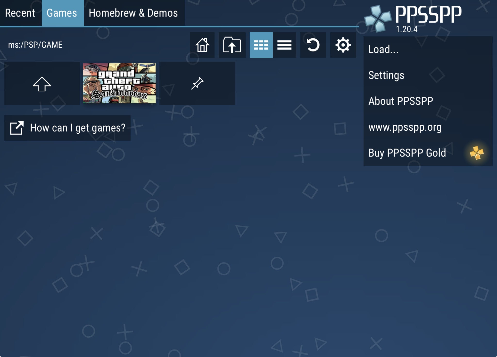
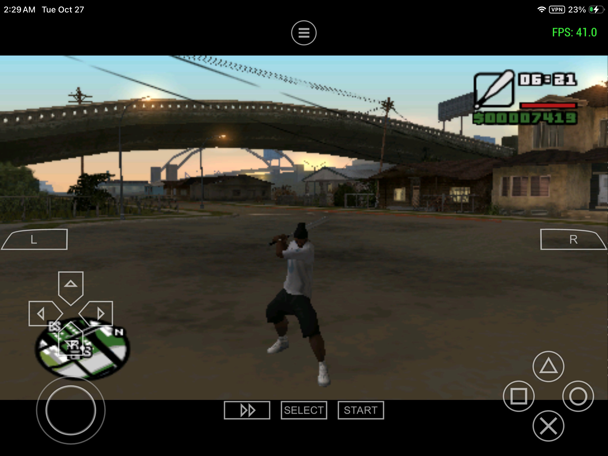

  <h1>🚗 GRAND THEFT AUTO: SAN ANDREAS</h1>
  
<strong>PS2 CLASSIC · PPSSPP EDITION</strong>

  
<em>Take the legendary city of San Andreas with you anywhere.</em>

  
  
  

## 🎮 GAMEPLAY

https://github.com/user-attachments/assets/3bcd9007-6b26-46f4-b51b-c18dfc5c1e31

## ✨ FEATURES

- Smooth gameplay on PPSSPP
- Portable GTA: San Andreas experience
- Full open-world action, missions, and exploration
- Easy to install and play
- Perfect for on-the-go gaming

## 📥 DOWNLOAD

  

  <strong>Mirror:</strong> MediaFire

## 🕹️ REQUIREMENTS

- PPSSPP Emulator installed
- Android / Windows / other supported platforms
- Enough storage space for game files
- A compatible device for smooth performance

## 📸 SCREENSHOTS

  
  

## 🧩 ABOUT

Experience the unforgettable story of CJ, the vast open world of San Andreas, and all the chaos that comes with it — now optimized for PPSSPP.

This project brings the classic game to a portable and smooth gaming setup with a clean, modern presentation.
